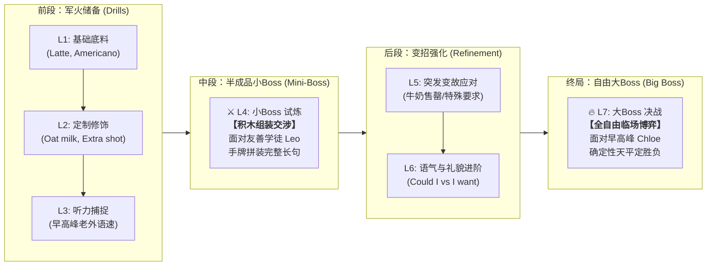
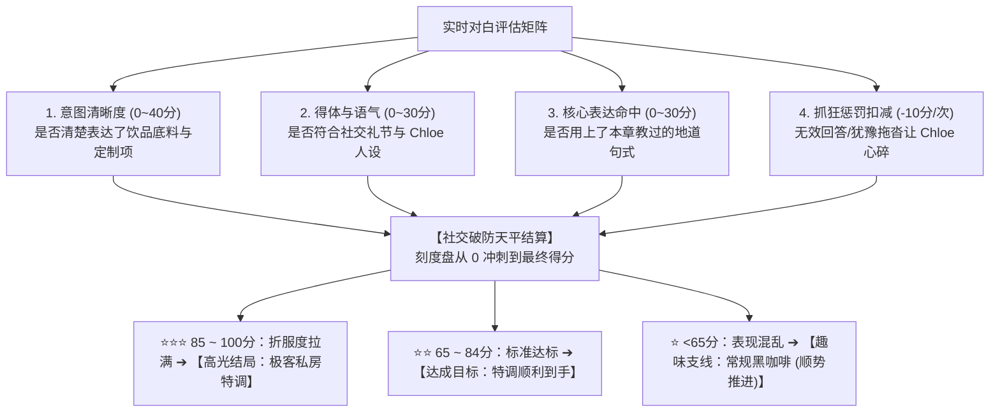

# AVG 口语实战系统 2.0：语用阶梯与确定性社交天平架构提案

> **版本**：v2.0.0-Proposal
> **定位**：从“孤立的跑团随机轻小说”，重构为“高沉浸、强针对、层层递进的章节章末实战考核（Capstone Simulation）”。
> **核心原则**：绝不搞无意义随机数，绝不搞局中冗余打扰，每关死磕 1 个核心地道表达公式。

---

## 一、 架构进化对比：1.0 跑团版 vs 2.0 语用阶梯版

| 维度               | 1.0 跑团试验版（已废弃）                                            | 2.0 语用阶梯版（新提案）                                                                        |
| :----------------- | :------------------------------------------------------------------ | :---------------------------------------------------------------------------------------------- |
| **模块定位** | 独立于主线的 AI 互动轻小说，体量过大且脱节                          | **多邻国式主线关卡的“章末实战考核”**（与主干紧密咬合）                                  |
| **决胜判定** | **D20 纯随机骰子 + 修正值**（易出现努力被随机数嘲弄的荒唐感） | **确定性【社交张力天平（Rapport Meter）】**（100% 凭真实表达定输赢）                      |
| **学习心流** | 每一句对白底下都塞满语法解析与润色（严重打断节奏且记不住）          | **局中纯沉浸、零打扰**；局后只提炼 **1 个最痛点的地道金句**跟读入库                 |
| **关卡坡度** | 3 轮做题直接空降大 Boss，小白极度容易失语卡壳                       | **7 关渐进式阶梯**：中途设 **L4 积木小 Boss** 辅导，终点设 **L7 自由大 Boss** |
| **通关约束** | 1 星保底顺势推进无门槛，极易被无脑乱码脚本通关                      | **总星数路障卡关制**：大 Boss 可拿 1 星保底，但下一大章需总星数达标                       |

---

## 二、 章节关卡推进全景（以“精品咖啡馆生存记”为例）

一个标准的业务大章节（Chapter）由 **7 个原子关卡** 组成，遵循二语习得的“渐进式责任释放”：



### 关卡 4（Mini-Boss）与关卡 7（Big Boss）的职能切分

#### 1. 关卡 4：新手学徒 Leo（积木式半成品交涉）

- **难度**：低压，友善。
- **界面交互**：提供 4 个语义卡槽供用户点击拼装：
  - `[Could I get...]` + `[an iced latte]` + `[with oat milk, extra shot]` + `[because I'm lactose intolerant]`
- **目的**：打碎孤立单词的壁垒，建立把零散词汇串成完整地道长句的**肌肉记忆与成就感**。

#### 2. 关卡 7：咖啡师 Chloe（全自由压力博弈）

- **难度**：早高峰，外冷内热，极度赶时间。
- **界面交互**：脱去卡槽辅助轮，全自由输入（支持语音与打字）。
- **目的**：检验用户是否能把在 L4 拼过的套路，在压力实战中独立复现。

---

## 三、 社交张力天平（Rapport Meter）：彻底取代 D20 骰子

摒弃随机数，采用全透明、有因果说服力的确定性公式：

$$
\text{Final Score (0} \sim \text{100)} = \text{Intent Clarity (40)} + \text{Pragmatic Tone (30)} + \text{Target Chunks (30)} - \text{Stalling Penalty (扣减)}
$$



> [!NOTE]
> **绝对的因果公信力**：结算卡不再显示随机骰点，而是逐项列出你的得分明细（“底料清晰 +40，礼貌得体 +25，未命中核心词 +0，拖沓扣减 -10 = 55分”）。用户心服口服，知道自己差在哪里。

---

## 四、 学情减负与记忆闭环（局中闭嘴，局后死磕一句）

针对“每句都弹润色导致什么都记不住”的痛点：

1. **局中对白流（极简状态反馈）**：
   - 气泡下方**彻底移除大段语法解析和润色文本**；
   - 只展示极简动态标签：`⚡ 意图明确 (+10)`、`💡 命中地道搭配 (+10)`、`💔 Chloe 抬手看表 (-10)`；
   - 保护玩家的临场社交紧张感与心流。
2. **局后单点狙击（唯一的学情交付物）**：
   - 通关后，系统不做冗长流水账，**只抓出整场表现最拉胯的一个失误点**，生成：
     > 🎯 **本局唯一带走金句**：
     > *"Could I get an oat milk latte, extra shot please?"*
     > 💡 **母语者套路**：先报底料饮品，再跟定制修饰，不要把燕麦奶当底料。
     >
   - 提供一个【一键跟读入库】挑战，读准后收录进个人知识图鉴，并同步进入次日复习卡。

---

## 五、 商业防刷与总星数路障（Star-Gated Progression）

为了防止用户靠发送空字符串/乱码连拿 1 星刷穿整个游戏：

```text
[Chapter 1: 街角咖啡馆] (满分 16 星)
├── L1~L3 基础关 (最高 6 星)
├── L4 积木小 Boss (最高 3 星)
├── L5~L6 变招关 (最高 4 星)
└── L7 自由大 Boss (最高 3 星)
                      ↓
           【解锁 Chapter 2 路障】
    ⚠️ 需要当前大章累计获得至少 12 颗星！
```

- **良性约束**：用户在大 Boss 战拿 1 星可以看完剧情，但不能直接开启下一个大场景；
- **自驱二刷**：强迫症和正常用户为了凑齐星数，会主动重玩小 Boss 或大 Boss，把地道表达真正练熟。
