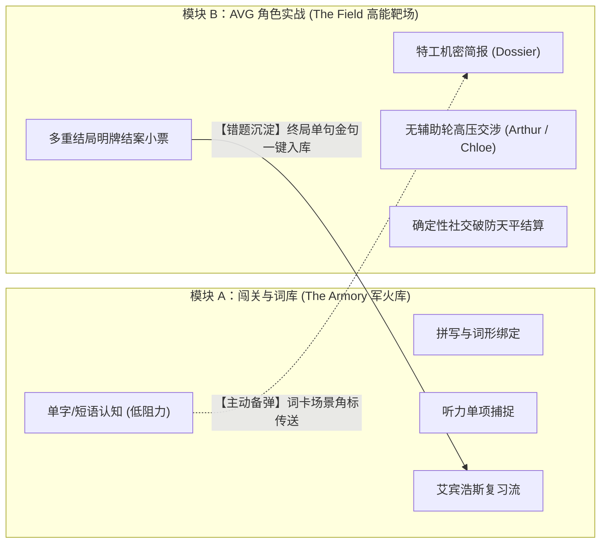
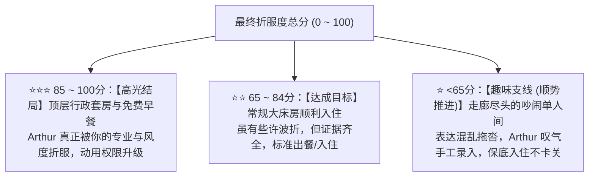

# enPromote 双引擎架构：闯关背词与 AVG 语用沙盘的“独立解耦与暗线互通”

> **版本**：v3.0.0-Final Architecture  
> **核心哲学**：**“物理隔离（谁也不给谁当门票），暗线互通（背词找弹药，实战沉淀错题）”**。  
> 彻底解决“25 分钟做题坐牢漏斗”与“D20 骰子戏弄努力”两大系统死穴。

---

## 一、 战略定位：从“强行捆绑”到“双引擎驱动”

在过去的多轮压力测试中，我们验证了两个极端方案的致命缺陷：
1. **强行串联（单向流水线）**：做完 25 分钟拼写与做题才能进 AVG，导致 85% 用户累死在半路，且严重分裂做题党与口语党；
2. **完全割裂（毫无关系的两张皮）**：各玩各的，无法形成产品壁垒，不如用户单独装一个背词 App + 一个 ChatGPT。

因此，最终决胜架构采用 **“双轮驱动、弱耦合暗度陈仓”**：

| 维度 | 模块 A：闯关练兵场（Adventure） | 模块 B：AVG 语用沙盘（Simulation） |
| :--- | :--- | :--- |
| **解决痛点** | 词汇量储备匮乏、看不懂、记不住词形 | 现实中面对外国人脑子空白、社恐害怕被怼、不敢开口 |
| **交互性质** | 闭卷做题、选项选择、翻卡、打卡进度条 | 开放对白、角色博弈、临场应变、情绪天平 |
| **典型场景** | 地铁通勤、马桶上、睡前 5 分钟碎片化刷量 | 沉浸式 3~5 分钟高能挑战、体验剧情分支 |
| **入口依赖** | **完全自由**，不强制要求打角色剧情 | **完全自由**，随时直接空降面对 NPC |

---

## 二、 核心秘密：“暗线互通”（Soft Synergy）闭环机制

两个模块在界面入口上完全独立（各占导航栏一个顶级 Tab），但底层数据通过 **“弹药提示”** 与 **“错题回流”** 形成极其丝滑的商业闭环：

### 1. 从模块 A 到模块 B：【词汇卡上的场景传送门】（主动出击）
- 当用户在背词模块中刷到高频核心词（如 `complimentary`、`oat milk`）时，卡片底部不再是死板的例句，而是展示一个极具诱惑力的小角标：
  > 🎮 **实战演练**：  
  > *“这个词可在【伦敦皇家酒店】中用于向大堂经理申请免费升房，去试试？”*  
  > **[ 立即空降挑战 ]**
- **心理机制**：将枯燥的被动背诵，转化为“手握新装备想去野怪身上试试”的游戏心流。

### 2. 从模块 B 到模块 A：【结案唯一金句的沉淀】（错题回流）
- 在 AVG 面对 Arthur 经理交涉完之后，系统根据整场表现抓出最痛点的一个失误，提炼为地道表达：
  > 🎯 **本局带走金句**：  
  > *"I was wondering if you could offer a complimentary upgrade?"*  
  > **[ 🎙️ 跟读挑战并收录入库 ]**
- 点击收录后，该长句自动同步进模块 A 的**“明日复习计划（Spaced Repetition Deck）”**。
- **心理机制**：刚在战场上吃过瘪，带着强烈的情绪记忆去复习，转化率达到顶峰。

---

## 三、 模块 B（AVG 角色实战）核心机制规格说明书

彻底摒弃 D20 骰子的随机戏弄与做题门票，模块 B 纯粹由以下四幕构成：

### 1. 第一幕：特工机密简报（Mission Dossier）替代前置做题
- 用户进入关卡后，首先看到的是一份**情境卷宗**：
  - **核心任务**：今晚大床房全满，说服老派苛刻的大堂经理 Arthur 为你查实预订并办理入住。
  - **目标弱点**：极其注重英伦礼节，吃软不吃硬；若出示有效证据且语气得体，会破例动用权限。
  - **携带武器库（核心词块）**：`have a reservation under...`、`confirmation number`、`complimentary upgrade`。
- **无需做题测试，看懂武器与目标，直接推门进场！**

### 2. 第二幕：实战交涉主舞台（无打扰沉浸博弈）
- **左侧状态**：NPC 动态立绘、当前态度（冷淡/挑眉/赞许/抓狂）、**社交破防天平（0~100）**；
- **右侧对白**：NPC 发起第一句冲突阻拦；
- **底部辅助**：
  - **战术弹药箱**（新手拐杖）：提供 3 个常用骨架碎片，点击可快速组装长句，杜绝卡壳失语；
  - **全自由输入框**：支持全手打或麦克风语音输入；
- **无打扰原则**：对话气泡下方**严禁弹大段语法解释和中文翻译**，只以轻量动态标签展示反馈（如 `⚡ 证据确凿 (+20)`、`🎩 礼仪得体 (+15)`）。

### 3. 第三幕：确定性社交破防天平结算（Rapport Meter）
摒弃一切随机数，结局 100% 由用户现场表现判定：

$$\text{Final Score} = \text{Intent Clarity (40)} + \text{Pragmatic Tone (30)} + \text{Target Chunks (30)} - \text{Hesitation Penalty (扣减)}$$

### 4. 第四幕：明牌打印消费结案小票（The Settlement Receipt）
- 战报以极具质感的**“真实账单/收据小票”**呈现；
- 清清楚楚逐项列出得分明细（为什么扣分、为什么加分），心服口服；
- 底部提供该场景**唯一核心破局金句**的跟读挑战按钮，完成学情闭环。

---

## 四、 商业化与防刷机制：总星数路障（Star-Gated Progression）

为了防止用户使用脚本或发送空字符连拿 1 星刷通所有关卡：
- **单关保底放行**：在任意场景中表现再差，也能拿到 1 星看完全部剧情，绝不挫败卡死；
- **大区宏观路障**：
  - 解锁下一个城市大区（如从《伦敦篇》到《纽约篇》），需要累计获得至少 **12 颗星**；
  - 逼迫摸鱼用户主动二刷前面拿了 1 星的场景，靠提升表达质量冲刺 3 星。

---

## 五、 实施蓝图与文件资产映射

本方案无缝复用现有代码资产，不推翻重来：

| 业务模块 | 对应项目代码路径 | 重构策略 |
| :--- | :--- | :--- |
| **模块 A（背词/听力/拼写）** | `frontend/src/views/adventure.vue``server/router/word.js` | 保留现有逻辑。只微调词库数据源与卡片角标，不破坏老功能。 |
| **模块 B（实战舞台与小票）** | `frontend/src/views/AvgTestView.vue` | 移除 D20 骰子弹窗，替换为确定性天平冲刺看板；增加机密卷宗前置卡。 |
| **后端评估与结算引擎** | `server/test-new-model/services/dndCheckEngine.js` | 升级为 `rapportScaleEngine.js`，改为纯确定性百分制账本。 |
| **场景数据编排** | `server/test-new-model/data/scenarioGraph.json` | 移除 DC 检定阈值，补充场景武器库词块与结案小票文案。 |
