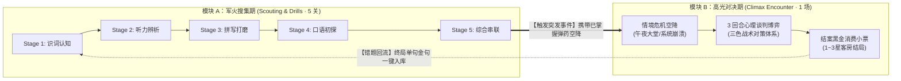
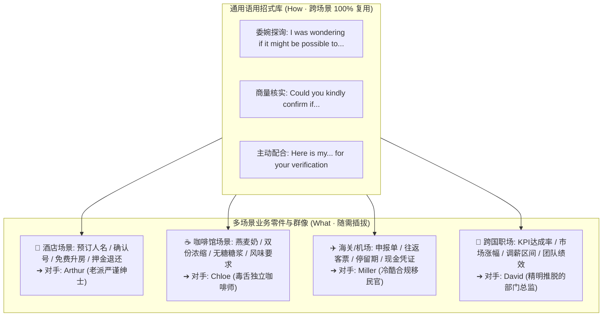

# enPromote 双引擎架构白皮书：5+1 沉浸式情境闯关与语用博弈沙盘

> **版本**：v4.0.0-Production Architecture Specification  
> **核心哲学**：**“前置零改动轻量搜集（输入），终局高光情境博弈（输出），场景资产极致复用，错题结案暗度陈仓”**。  
> **明确交付物**：**“通用社交润滑招式（How · 70% 跨场景通用情商）+ 场景业务事实零件（What · 30% 随需插拔）”**，彻底终结“机械死记例句”与“面对老外脑子空白”的双重顽疾。

---

## 一、 顶层架构：【5+1 沉浸式情境闯关】流水线模型

系统彻底淘汰早期“让玩家连续做题 30 分钟才能进剧情”的挫败流水线，确立为工业化标准的 **【5+1 沉浸式情境单元】**：



### 1.1 模块分工定位与契约
| 维度 | 模块 A：基础闯关与词库（Adventure） | 模块 B：AVG 语用博弈沙盘（Simulation） |
| :--- | :--- | :--- |
| **功能定位** | 弹药搜集与认知输入（The Armory） | 高光消耗与实战交涉（The Boss Fight） |
| **交互形式** | 线性微步做题（单选、拼写、跟读、连线） | 拟真对白博弈、NPC 情绪天平、多结局分支 |
| **心理心流** | 低压力、碎片化、确定性渐进成长 | 高度沉浸、临场应变、成年人情商博弈 |
| **单局耗时** | 3 ~ 5 分钟完成 5 个微关卡 | 2 ~ 3 分钟完成 3 回合短平快交涉 |
| **入口自由度** | 随时独立刷关背词，自由无阻 | 支持独立直接挑战，亦可由模块 A 第 5 关高光传送 |

### 1.2 模块 A “零伤筋动骨”改造方案
为确保工程稳定性与极高投入产出比（ROI），**坚决不动模块 A 的底层题目渲染与评分算法**：
1. **底层骨架零篡改**：关卡树系统、星级计算、艾宾浩斯复习流保持 100% 独立稳定；
2. **轻量数据增量打标**：仅在场景词库 JSON 中，为重点词汇补充 `combatRole` 语义标签（如 `reservation` 标为 `evidence` 事实证据，`wondering` 标为 `stance` 社交招式）；
3. **第 5 关出口挂载**：通关结算弹窗由传统的“恭喜通关”改造为**剧情触发弹窗**：  
   > *“🚨 突发事件！你已收集齐所有凭证，伦敦皇家花园酒店系统崩溃查无此单，Arthur 经理正准备建议你另寻别处，立刻前往前台破冰交涉！”*  
   > **[ 立即前往前台对决 ]**

---

## 二、 模块 B 核心玩法设计：【3 回合心理谈判战】

### 2.1 避开“伪卡牌陷阱”
传统教育游戏常将单项选择题简单包装为“卡牌”，玩家看颜色乱点即可通关。本方案建立真正的**风险与收益博弈（Timing & Risk）**：
*   **固定规格**：每场交涉严格限制为 **3 回合（3 Rounds）**，短平快，拒绝拖沓；
*   **出牌顺序决策**：开局直奔主题（索要升房）会被 NPC 判定为贪婪并遭冷酷驳回；先出示事实证据建立合法性，再以得体姿态试探，方能触发高光暴击。

### 2.2 棋盘状态：NPC 心防与好感天平（Rapport Meter）
*   **NPC 状态栏**：
    *   **好感天平（0 ~ 100）**：当前情绪状态（冰冷审视 ➔ 眉头微皱 ➔ 扶眼镜沉思 ➔ 优雅欠身微笑）；
    *   **隐秘弱点（Soft Spot）**：例如 Arthur 极度看重“绅士风度”与“程序合规”，对粗暴命令零容忍；
    *   **防一回杀节奏锁（Anti-OTK Lock）**：在第一阶段未查明身份前，大喊升房将触发严厉惩罚（扣除 15 分）。

### 2.3 玩家武器：三色战术对策体系（The Tactical Triad）
每回合 NPC 抛出阻拦或质疑后，系统呈现风格迥异的三色战术手牌：

```
                    【 Arthur: 系统查无此记录，请问您是在哪家平台预订的？】
                                          ▼
┌─────────────────────────┐ ┌─────────────────────────┐ ┌─────────────────────────┐
│ 🟢 绿卡【高情商委婉】   │ │ 🔵 蓝卡【确凿事实】     │ │ 🟣 紫卡【极速索求】     │
│ Diplomacy               │ │ Evidence                │ │ Bold Ask                │
├─────────────────────────┤ ├─────────────────────────┤ ├─────────────────────────┤
│ "I was wondering if     │ │ "Certainly, here is     │ │ "I paid in full, so     │
│ you could check your    │ │ my confirmation code    │ │ I'd like my room        │
│ backup terminal?"       │ │ LON-88219 and passport."│ │ sorted out right now."  │
├─────────────────────────┤ ├─────────────────────────┤ ├─────────────────────────┤
│ 效果：好感度 +20        │ │ 效果：事实确认通过      │ │ 效果：好感度 -20        │
│ 虚拟语气破冰，态度软化  │ │ 提供关键凭证，稳住阵脚  │ │ 态度生硬，激怒挑剔NPC   │
└─────────────────────────┘ └─────────────────────────┘ └─────────────────────────┘
```

### 2.4 双模态输入解耦：辅助装配流 vs 脱稿大师流（Speak 模式）
为兼顾轻度小白与硬核口语学习者，输入方式实行自由解耦：
*   **默认模式（战术装配流 · Assisted）**：
    *   直接点击手牌，基于 **乐高智能磁吸（Smart Slot-filling）** 自动补齐语法胶水词（助动词、从句引导词、介词），消除多余省略号，直接合体为标准长句；
    *   保留 `[Alex]`、`[LON-88219]` 等高亮参数槽，允许玩家微打字输入真实信息；
    *   稳定拿 2 星通关（标准大床房），无打字焦虑。
*   **高难模式（脱稿大师流 · Mastery / Speak 模式）**：
    *   折叠手牌，仅在顶栏保留战术目标灵感（Hint）；
    *   玩家完全通过键盘手打或麦克风语音输入；
    *   后台 LLM 扫描玩家表达，若不仅满足事实更自主打出 `I was wondering if...` 等高阶软化剂，触发**“高情商暴击”**，独占解锁 3 星顶层行政套房与专属大师战报！

---

## 三、 场景 100% 复用的艺术化突围策略

在模块 A 与模块 B 场景完全相同的物理约束下，通过四重维度重构，彻底杜绝“换皮凑数”的廉价感：

```
                    【 场景 100% 复用的艺术突围 】
     模块 A（白天的明亮日常 · 学习态）        模块 B（深夜的突发危机 · 战斗态）
  ┌─────────────────────────────────┐      ┌─────────────────────────────────┐
  │ · 明媚日光，轻柔背景爵士音乐     │  VS  │ · 午夜冷蓝 (Dark Mode LUT)       │
  │ · 中远景视点，单词悬浮在物体上   │      │ · 窗外伦敦暴雨，壁炉炭火微光     │
  │ · 心理安全：温和认知吸收         │      │ · 电影过肩主观视角，压迫对峙     │
  └─────────────────────────────────┘      └─────────────────────────────────┘
```

1.  **时空反转（表里世界）**：
    *   模块 A 为日间明亮清爽色调，BGM 为轻松舒缓的晨间爵士；
    *   模块 B 通过夜间冷蓝调色图层（Dark LUT）转为深夜 23:30 暴雨交加的冷雨夜，背景音加入真实的雨滴敲击声与低音大提琴，瞬间拉满戏剧张力。
2.  **视角解构（Cinematic POV）**：
    *   模块 B 采用过肩电影视角，背景进行景深虚化（Depth of Field），将视觉聚焦点牢牢钉在 NPC（Arthur）的金丝眼镜反光、挑眉微表情与前台日志本上。
3.  **空间折叠与弹药感知**：
    *   模块 A 中出现过的场景元素（如大堂夜审告示牌、房型价目表），在模块 B 中直接转化为交涉时的**关键破局筹码**，形成“我白天看过的每个细节都在此刻成为了武器”的顿悟感。

---

## 四、 跨场景通用工业化流水线（The Content Pipeline）

本套方法论完全抽象为工业化通用标准，具备边际成本趋零的规模化复制能力：

$$\text{场景标准单元} = \text{通用高情商招式 (How · 70%)} + \text{场景专有业务零件 (What · 30%)} + \text{专属性格 NPC}$$



### 4.1 单关配置标准模版（策划 1 天量产）
每个新关卡仅需向 `server/test-new-model/data/scenarioGraph.json` 录入如下极简结构：
*   `scenarioId` & `sceneVisual`：场景名称与光影氛围定义；
*   `dramaticContext`：NPC 当前心理状态（疲惫/暴躁/警惕）与隐秘弱点（Soft Spot）；
*   `inventoryWeapons`：3 个通用招式 + 4 个业务零件短语；
*   `smartSnapMatrix`：招式与零件磁吸配对的地道成句字典；
*   `endings`：3 档星级专属结案小票文本（高光 / 达标 / 顺势推进）。

---

## 五、 教育心理学与长效留存机制（Gamification Design）

### 5.1 Hook 模型驱动循环
*   **触发（Trigger）**：外部章节解锁提示 + 内部“拿下挑剔 Arthur 冲击 3 星”的好胜心；
*   **行动（Action）**：模块 A 极低门槛刷词（3分钟） $\rightarrow$ 模块 B 紧张刺激三回合博弈（2分钟）；
*   **多变酬赏（Variable Reward）**：
    *   *胜任感（自我）*：亲眼目睹严苛前台被自己地道的英文征服；
    *   *社交货币（部族）*：黑金质感账单小票（印有玩家 ID、房型、NPC 亲笔评语与 MVP 金句），高度利于社交分享；
    *   *探索驱动（猎物）*：解锁 NPC 隐藏私房档案与后续章节专属彩蛋。
*   **投入（Investment）**：每局立下奇功的唯一金句自动收录入库，沉淀为次日模块 A 晨读资产。

### 5.2 星级特权与常客声望机制
*   **废除卡死主线的旧制**：1 星保底（顺势推进）即可解锁下一章，绝不卡死内容消费；
*   **常客记忆沉淀（Rapport Continuity）**：
    在 Chapter 1 酒店拿下 Arthur 的 3 星后，Chapter 4 租房再次遇到他时，Arthur 扶眼镜触发专属问候：  
    > *"Ah, Mr. Alex. I trust your stay at the Royal Garden was satisfactory. Now, regarding the lease agreement..."*

---

## 六、 实施蓝图与项目代码资产映射

| 业务模块 | 对应项目代码路径 | 状态与改造策略 |
| :--- | :--- | :--- |
| **模块 A（背词/听辨/拼写）** | `frontend/src/views/adventure.vue`<br/>`server/router/word.js` | **运行中**。保持底层结构稳定，仅在 Stage 5 结算后挂载事件弹窗与传送路由。 |
| **模块 B（实战舞台与小票）** | `frontend/src/views/AvgTestView.vue` | **已完成**。上线极简三色战术装配坞、乐高磁吸吸附、收起/展开折叠条与结案黑金小票。 |
| **确定性天平纯算引擎** | `server/test-new-model/services/rapportScaleEngine.js` | **已完成**。落地事实核查（40）+ 语块（30）+ 礼貌（30）+ 防抢跑节奏锁。 |
| **AI 深度交涉与评估** | `server/test-new-model/services/aiService.js` | **已完成**。接入 Gemini 模型拟真角色扮演、实时微表情与动态游戏标签。 |
| **场景与群像资产配置** | `server/test-new-model/data/scenarioGraph.json`<br/>`server/test-new-model/data/npcProfiles.json` | **已升级 v4.0**。配置 `smartSnapMatrix` 磁吸字典，预留 Chloe/Leo/Miller 标准插槽。 |
