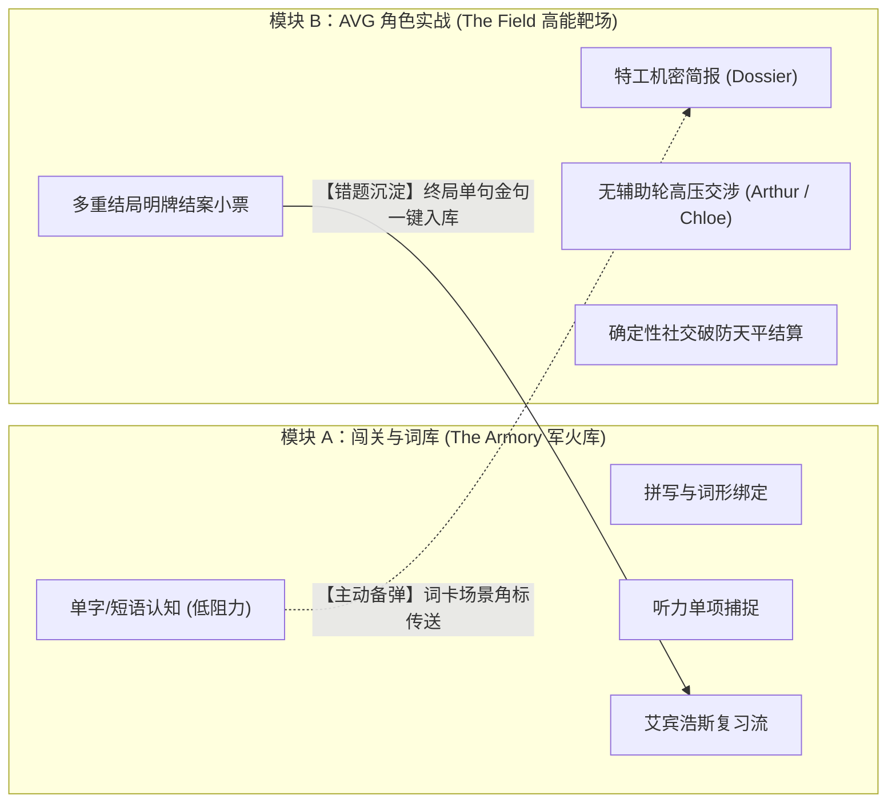
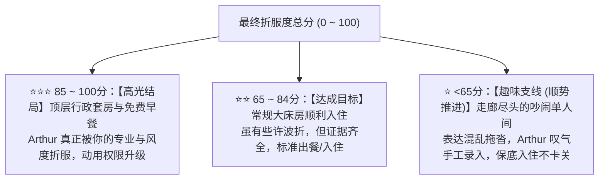
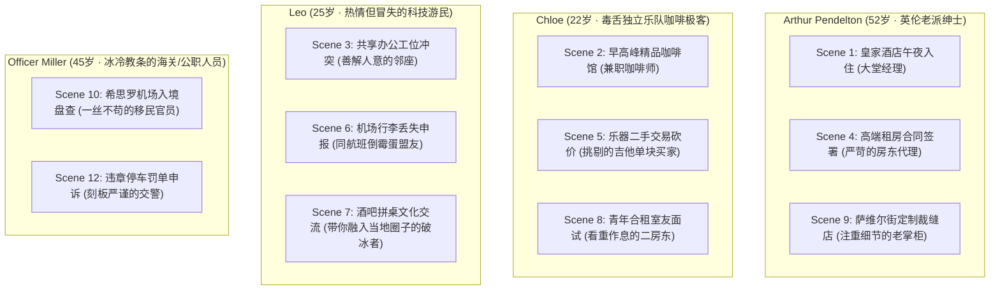

# enPromote 双引擎架构：闯关背词与 AVG 语用沙盘的“独立解耦与暗线互通”

> **版本**：v3.1.0-Production Architecture  
> **核心哲学**：**“物理隔离（谁也不给谁当门票），暗线互通（背词找弹药，实战沉淀错题）”**。  
> 彻底解决“25 分钟做题坐牢漏斗”、“D20 骰子戏弄努力”与“虚假老好人陪聊”三大系统死穴。

---

## 一、 战略定位：从“强行捆绑”到“双引擎驱动”

在过去的多轮压力测试中，我们验证了两个极端方案的致命缺陷：
1. **强行串联（单向流水线）**：做完 25 分钟拼写与做题才能进 AVG，导致 85% 用户累死在半路，且严重分裂做题党与口语党；
2. **完全割裂（毫无关系的两张皮）**：各玩各的，无法形成产品壁垒，不如用户单独装一个背词 App + 一个 ChatGPT。

因此，最终决胜架构采用 **“双轮驱动、弱耦合暗度陈仓”**：

| 维度 | 模块 A：闯关练兵场（Adventure） | 模块 B：AVG 语用沙盘（Simulation） |
| :--- | :--- | :--- |
| **解决痛点** | 词汇量储备匮乏、看不懂、记不住词形 | 现实中面对外国人脑子空白、社恐害怕被怼、不敢开口 |
| **交互性质** | 闭卷做题、选项选择、翻卡、打卡进度条 | 开放对白、角色博弈、临场应变、情绪天平 |
| **典型场景** | 地铁通勤、马桶上、睡前 5 分钟碎片化刷量 | 沉浸式 2~4 分钟高能挑战、体验剧情分支 |
| **入口依赖** | **完全自由**，不强制要求打角色剧情 | **完全自由**，随时直接空降面对 NPC |

---

## 二、 核心秘密：“暗线互通”（Soft Synergy）闭环机制

两个模块在界面入口上完全独立（各占导航栏一个顶级 Tab），但底层数据通过 **“弹药提示”** 与 **“错题回流”** 形成极其丝滑的商业闭环：

### 1. 从模块 A 到模块 B：【词汇卡上的场景传送门】（主动出击）
- 当用户在背词模块中刷到高频核心词（如 `complimentary`、`oat milk`）时，卡片底部不再是死板的例句，而是展示一个极具诱惑力的小角标：
  > 🎮 **实战演练**：  
  > *“这个词可在【伦敦皇家酒店】中用于向大堂经理申请免费升房，去试试？”*  
  > **[ 立即空降挑战 ]**
- **心理机制**：将枯燥的被动背诵，转化为“手握新装备想去野怪身上试试”的游戏心流。

### 2. 从模块 B 到模块 A：【结案唯一金句的沉淀】（错题回流）
- 在 AVG 面对 Arthur 经理交涉完之后，系统根据整场表现抓出最痛点的一个失误，提炼为地道表达：
  > 🎯 **本局带走金句**：  
  > *"I was wondering if you could offer a complimentary upgrade?"*  
  > **[ 🎙️ 跟读挑战并收录入库 ]**
- 点击收录后，该长句自动同步进模块 A 的**“明日复习计划（Spaced Repetition Deck）”**。
- **心理机制**：刚在战场上吃过瘪，带着强烈的情绪记忆去复习，转化率达到顶峰。

---

## 三、 模块 B（AVG 角色实战）核心机制规格说明书

彻底摒弃 D20 骰子的随机戏弄与做题门票，模块 B 纯粹由以下四幕构成：

### 1. 第一幕：特工机密简报（Mission Dossier）替代前置做题
- 用户进入关卡后，首先看到的是一份**情境卷宗**：
  - **核心任务**：今晚大床房全满，说服老派苛刻的大堂经理 Arthur 为你查实预订并办理入住。
  - **目标弱点**：极其注重英伦礼节，吃软不吃硬；若出示有效证据且语气得体，会破例动用权限。
  - **携带武器库（核心词块）**：`have a reservation under...`、`confirmation number`、`complimentary upgrade`。
- **无需做题测试，看懂武器与目标，直接推门进场！**

### 2. 第二幕：实战交涉主舞台（无打扰沉浸博弈）
- **左侧状态**：NPC 动态立绘、当前态度（冷淡/挑眉/赞许/抓狂）、**社交破防天平（0~100）**；
- **右侧对白**：NPC 发起第一句冲突阻拦；
- **底部辅助**：
  - **战术武器库抽屉**（新手拐杖）：提供常用骨架碎片，点击可快速组装长句，杜绝卡壳失语；
  - **全自由输入框**：支持全手打或麦克风语音输入；
- **无打扰原则**：对话气泡下方**严禁弹大段语法解释和中文翻译**，只以轻量动态标签展示反馈（如 `⚡ 证据确凿 (+20)`、`🎩 礼仪得体 (+15)`、`⚠️ 操之过急 (-15)`）。

### 3. 第三幕：确定性社交破防天平结算（Rapport Meter）
摒弃一切随机数，由客观事实、核心词块与 LLM 礼貌得体度共同判定：

$$\text{Final Score} = \text{Fact Clarity (40)} + \text{Target Chunks (30)} + \text{Pragmatic Tone (30)} - \text{Premature/Rude Deductions (扣减)}$$

- **防一回杀节奏锁 (Anti-OTK Lock)**：阶段一查实身份，阶段二解锁升房诉求；第一轮抢跑直接索要升房触发惩罚（-15 分），强制有来有回的心理战。

### 4. 第四幕：明牌打印消费结案小票（The Settlement Receipt）
- 战报以极具质感的**“真实账单/收据小票”**呈现；
- 清清楚楚逐项列出得分明细（事实 40 + 词块 30 + 礼貌 26 - 扣减 0 = 96 分），心服口服；
- 底部提供该场景**唯一核心破局金句**的跟读挑战按钮，完成学情闭环。

---

## 四、 常驻生活轨迹型群像体系与心理安全垫架构（The Living Ensemble）

针对“每关都是新 NPC 导致制作成本爆炸且零情感”与“多邻国变色龙 NPC 出戏搞笑”的双重矛盾，建立**生活轨迹型常驻群像体系**：

### 1. 为什么生活轨迹群像是最优解？
1. **真实感自洽（杜绝全能变色龙）**：
   Arthur 永远不会去咖啡馆打奶泡，Chloe 永远不会去守机场海关。他们在各自的生活半径里活动。用户在酒店见过严谨的 Arthur，下一次在租房签合同时又碰到了他，世界观连贯且真实。
2. **“心理安全垫”的真正来源：性格的可预期性（Predictability）**：
   - 用户面对 Chloe 时心里是有安全预期的：*“我知道她嘴毒、赶时间，但我只要表达干脆利落，她骨子里非常讲理”*；
   - 用户面对 Leo 时知道他温和、喜欢共情，适合用来建立信心；
   - **安全垫不是来源于“NPC 毫无原则地夸我”，而是来源于“我摸清了他的脾气，我知道如何用正确的策略拿下他”！**
3. **跨章节熟客记忆沉淀（Rapport Continuity）**：
   在 Chapter 1 酒店入住拿下 Arthur 的 3 星行政套房后，Chapter 4 找他租房时，Arthur 抬眼扶眼镜认出你：
   > *"Ah, Mr. Alex. I trust your stay at the Royal Garden was satisfactory. Now, regarding the lease agreement..."*
   前置努力被游戏世界长久铭记，带来无与伦比的成就感。

---

## 五、 商业化、防刷与声望徽章体系

1. **主线推进（章节解锁）**：
   - 彻底废除“必须攒够 12 星才能进下一章”的死锁设计；
   - 只要拿到 1 星保底（顺势推进）即可解锁下一个场景，绝不卡死主线。
2. **星级的作用（荣誉图鉴与熟客特权）**：
   - 拿 1 星：获得称号【狼狈的过客】；
   - 拿 3 星：点亮【场景黄金结案小票】、解锁 NPC 个人私房档案、并在后续该 NPC 的关联场景中激活**“熟客致意”专属彩蛋对白**；
   - 强迫症用户会为了荣誉和故事全收集自发二刷，彻底告别逼肝。

---

## 六、 实施蓝图与文件资产映射

| 业务模块 | 对应项目代码路径 | 重构策略 |
| :--- | :--- | :--- |
| **模块 A（背词/听力/拼写）** | `frontend/src/views/adventure.vue``server/router/word.js` | 保持独立稳定运行，补充场景词块角标与传送门链接。 |
| **模块 B（实战舞台与小票）** | `frontend/src/views/AvgTestView.vue` | 已全面重构：上线机密卷宗、社交破防天平、战术武器库与结案小票。 |
| **确定性天平纯算引擎** | `server/test-new-model/services/rapportScaleEngine.js` | 已落地：客观事实核验（40）+ 词块（30）+ 礼貌（30）+ 防一回杀锁。 |
| **AI 对白与小票生成** | `server/test-new-model/services/aiService.js` | 已支持 Arthur 角色扮演、极简动态标签与单句破局金句提炼。 |
| **场景与群像资产配置** | `server/test-new-model/data/npcProfiles.json``scenarioGraph.json` | 首发落地 Arthur 酒店午夜入住场景，预留 Chloe、Leo、Miller 轨迹插槽。 |
