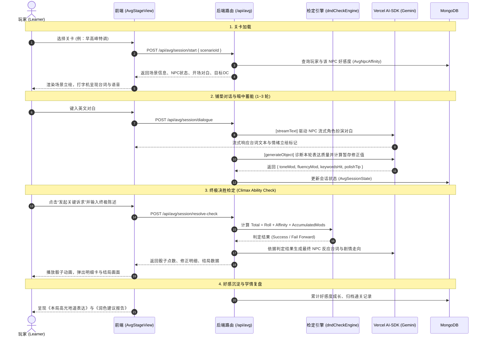

# 🎲 英语学习互动式 AVG 与 DND 检定系统架构设计文档

> **版本**：v1.0.0
> **状态**：方案已确立（待实施）
> **后端代码隔离目录**：`server/test-new-model/`
> **核心依赖**：Vercel AI SDK (`ai` + `@ai-sdk/google`) + Vue 3 + MongoDB

---

## 目录

- [一、 模块定位与核心玩法哲学](#一-模块定位与核心玩法哲学)
- [二、 核心玩法与数值规则设计](#二-核心玩法与数值规则设计)
- [三、 业务全流程时序与状态机](#三-业务全流程时序与状态机)
- [四、 存储结构与数据模型定义](#四-存储结构与数据模型定义)
- [五、 后端架构与 AI SDK 集成设计](#五-后端架构与-ai-sdk-集成设计)
- [六、 前端架构与组件拆分](#六-前端架构与组件拆分)
- [七、 实施演进路线图](#七-实施演进路线图)

---

## 一、 模块定位与核心玩法哲学

### 1.1 现状痛点

原有“角色剧情”模块在实现层面本质是对主线闯关模式（拼写卡、听力选择题、填空题）的换皮包装。学习者在进行剧情挑战时，缺乏沉浸感与剧情推演感，依然处于“被动做题”的枯燥心流中。

### 1.2 重构愿景

将角色剧情彻底改造为**固定 NPC 群像宇宙下的沉浸式互动 AVG（视觉小说）**，并深度融合 **DND（龙与地下城）技能检定机制**：

- **固定 NPC 群像**：打造辨识度高、性格鲜明的生活化 NPC（如毒舌但讲究效率的咖啡师 Chloe、严谨老派的绅士 Arthur 等）。
- **语言即武器（Language as Ability）**：玩家不是在“做题”，而是用英语作为与 NPC 交涉、推进故事、化解危机的工具。
- **跑团检定爽感（DND Check）**：通过“语言质量”为检定赢取高额加成，体验“我的地道英语扳回了局面”的极强正向反馈。

---

## 二、 核心玩法与数值规则设计

### 2.1 检定核心公式

$$
\Large \text{Total Check (最终检定值)} = \text{Base Roll (基础骰点)} + \sum \text{Modifiers (加成修正值)}
$$

判定标准：

- **$\text{Total Check} \ge \text{DC (场景难度目标)}$**：检定成功（Success），达成目的并推动剧情正向发展。
- **$\text{Total Check} < \text{DC}$**：触发 **Fail Forward（顺势推进）**，不直接 Game Over，而是展开诙谐有趣的尴尬/补救支线，兼顾容错与幽默感。
- **大成功（Critical Success）**：骰出极值或超高溢出分，解锁 NPC 隐藏好感剧情与专属成就。

### 2.2 核心机制：双轨离散指示器与筹码模型 (Dual-Track Token System)

经过深度辩论与反思，系统彻底摒弃了“黑箱浮点数/连续函数算法”，改用符合跑团直觉且透明明牌的**双轨离散模型**：

```text
┌─────────────────────────────────────────────────────────────────┐
│                      【双轨离散指示器模型】                       │
├─────────────────────────────────────────────────────────────────┤
│ 轨 1：NPC 耐心槽 (Patience Hearts) [约束坏表现，自然封底]         │
│  ❤️❤️❤️ (满额 3 颗心)                                            │
│  - 每轮表达出现粗鲁失礼或严重中伤 (Poor) ➔ 碎裂 1 颗心 💔         │
│  - 超过第 5 轮依然拖沓闲聊 ➔ 碎裂 1 颗心 💔 (早高峰催促)          │
│  - 心碎惩罚：每碎 1 颗心，最终检定扣除 -1 点 (上限最多扣 -3 点)   │
│  - 3 颗心全碎 ➔ 触发社交危机警告，强行进入决胜检定                │
├─────────────────────────────────────────────────────────────────┤
│ 轨 2：语言筹码与词汇印章 (Tokens & Stamps) [激励好表现，明牌可见] │
│  - 每一句优秀地道表达 (Good) ➔ 赢得 1 枚【交涉筹码 🪙】(上限 3)    │
│  - 每一轮自然命中推荐核心词 ➔ 点亮 1 枚【词汇印章 🎯】(上限 3)    │
│  - 历史熟客羁绊加成 ➔ 【好感基准 💖】(+1 点)                     │
└─────────────────────────────────────────────────────────────────┘
```

#### 检定修正值明牌计算公式：

$$
\text{Total Modifiers} = \underbrace{\text{筹码数 (0~3)}}_{\text{优秀对白}} + \underbrace{\text{词汇印章 (0~3)}}_{\text{地道词汇}} + \underbrace{\text{熟客好感 (+1)}}_{\text{基础羁绊}} - \underbrace{\text{碎心数 (0~3)}}_{\text{失礼与超时惩罚}}
$$

- **总修正区间**：安全收敛在 **$-2 \sim +7$** 之间，完美契合 D20 骰子数学空间，绝不喧宾夺主。
- **全明牌可解释**：每个点数都有据可循，绝不存在“为什么我第 3 句说得好却加分变少”的黑箱困惑！

### 2.3 节奏与心流控制（决胜检定 Climax Check）

- **常规回合（1~3 轮）**：沉浸式破冰与意图铺垫。玩家实时看着筹码掉落、心跳波动。
- **高潮决胜（Climax Check）**：玩家发起关键交涉，一锤定音掷骰。
- **决胜后正式封板（Completed & Sealed）**：检定完成后本关立即进入**结算归档状态**，锁定输入框，杜绝后续无意义闲聊，保护大模型算力，剧情紧凑收官。

---

## 三、 业务全流程时序与状态机



---

## 四、 存储结构与数据模型定义

代码与配置文件统一存放于隔离目录：`server/test-new-model/`。

### 4.1 静态剧本资产配置（JSON）

#### (1) `server/test-new-model/data/npcProfiles.json`

定义固定 NPC 群像库的人设、台词风格、立绘差分与语音参数：

```json
{
  "chloe": {
    "npcId": "chloe",
    "name": "Chloe",
    "title": "咖啡店兼职咖啡师",
    "persona": "外冷内热，极度注重效率，反感毫无主见的啰嗦，偏爱地道直接的表达。",
    "tonePreference": "Concise, confident, casual-native",
    "tabooTone": "Overly formal, repetitive, slow",
    "voice": "en-US-Neural2-F",
    "avatarAssets": {
      "neutral": "/avatars/chloe/neutral.png",
      "annoyed": "/avatars/chloe/annoyed.png",
      "surprised": "/avatars/chloe/surprised.png",
      "pleased": "/avatars/chloe/pleased.png"
    }
  },
  "arthur": {
    "npcId": "arthur",
    "name": "Arthur Pendelton",
    "title": "英伦老派公寓管家",
    "persona": "严谨优雅，注重礼貌与繁文缛节，对粗鲁或过于随意的请求极为反感。",
    "tonePreference": "Polite, modal verbs (Could/Would), respectful",
    "tabooTone": "Imperative (Give me/I want), slang",
    "voice": "en-GB-Neural2-B",
    "avatarAssets": {
      "neutral": "/avatars/arthur/neutral.png",
      "skeptical": "/avatars/arthur/skeptical.png",
      "approving": "/avatars/arthur/approving.png"
    }
  }
}
```

#### (2) `server/test-new-model/data/scenarioGraph.json`（自包含剧本单集 Episode）

每个关卡即为一个自包含的剧本单集（Episode）。针对“人物为何出现在此、当前心态为何”的诉求，通过内嵌的 **`dramaticContext`（情境戏剧动机块）** 就地收敛，兼顾戏剧深度与极低维护成本：

```json
{
  "scenario_coffee_01": {
    "scenarioId": "scenario_coffee_01",
    "title": "早高峰的破例特调",
    "sceneVisual": {
      "background": "/backgrounds/coffee_rush.jpg",
      "ambienceAudio": "/audio/ambience/cafe_rush.mp3"
    },
    "npcId": "chloe",
  
    // 🎭 核心设计：情境戏剧动机块 (Dramatic Context)
    // 直接注入 AI System Prompt，赋予 NPC 极强的当下动机与鲜活情绪
    "dramaticContext": {
      "whyHere": "Chloe 正在给突发高烧的同事代早班，已经连续站立工作了 4 个小时，咖啡机蒸奶棒刚才还堵塞了一次。",
      "currentMentalState": "烦躁度 85%，严重缺觉，手腕酸痛，只想迅速清空眼前的长队，准点换班去参加傍晚的独立乐队排练。",
      "immediateGoal": "拒绝一切复杂的非标定制，快速出餐，谁耽误时间就怼谁。",
      "hiddenSoftSpot": "虽然嘴碎厌烦，但骨子里是个精品咖啡极客。若有顾客能精准、得体、专业地描述风味与配方（而不是犹豫不决），会瞬间破防并产生专业认同感。"
    },

    "targetDc": 14,
    "openingLine": "Next! Keep it snappy, the morning queue is out the door. What can I get started for you?",
    "objectiveDescription": "说服濒临崩溃、不耐烦的 Chloe 在早高峰为你制作一份非标定制的低糖燕麦奶特调。",
    "recommendedKeywords": [
      { "word": "oat milk", "meaning": "燕麦奶" },
      { "word": "extra shot", "meaning": "浓缩加份" },
      { "word": "lactose intolerant", "meaning": "乳糖不耐" },
      { "word": "syrup", "meaning": "糖浆" }
    ],
    "climaxThresholdRound": 3,
    "endings": {
      "critical_success": {
        "title": "【高光结局】极客的私房配方",
        "description": "Chloe 被你专业而利落的表达彻底折服，破例拿出了她自己调配的浓缩豆，好感度大幅飙升！"
      },
      "success": {
        "title": "【达成目标】特调顺利到手",
        "description": "凭借客气委婉的沟通，Chloe 尽管嘴上抱怨，依然利索地为你换上了燕麦奶。"
      },
      "fail_forward": {
        "title": "【趣味支线】流水线的妥协",
        "description": "早高峰不容犹豫，Chloe 直接塞给你一杯常规美式，但吐槽中教了你一句地道口语点单句式。"
      }
    }
  }
}
```

### 4.2 MongoDB 动态数据模型（Mongoose Schemas）

#### (1) `server/test-new-model/models/AvgNpcAffinity.js`

记录用户与固定 NPC 的持久化羁绊关系：

```javascript
const mongoose = require('mongoose');

const AvgNpcAffinitySchema = new mongoose.Schema({
  userId: { type: String, required: true, index: true },
  npcId: { type: String, required: true, index: true },
  affinityScore: { type: Number, default: 0 }, // 好感总积分 (-20 ~ +100)
  level: { 
    type: String, 
    enum: ['Cold', 'Neutral', 'Acquaintance', 'Friendly', 'Trusted'], 
    default: 'Neutral' 
  },
  unlockedEndings: [{ type: String }],
  updatedAt: { type: Date, default: Date.now }
});

AvgNpcAffinitySchema.index({ userId: 1, npcId: 1 }, { unique: true });
module.exports = mongoose.model('AvgNpcAffinity', AvgNpcAffinitySchema);
```

#### (2) `server/test-new-model/models/AvgSessionState.js`

记录当前单场对局的运行时数据，支持中断恢复与复盘总结：

```javascript
const mongoose = require('mongoose');

const AvgSessionStateSchema = new mongoose.Schema({
  sessionId: { type: String, required: true, unique: true },
  userId: { type: String, required: true, index: true },
  scenarioId: { type: String, required: true },
  npcId: { type: String, required: true },
  currentRound: { type: Number, default: 0 },
  messages: [{
    role: { type: String, enum: ['user', 'assistant', 'system'] },
    content: { type: String, required: true },
    emotion: { type: String, default: 'neutral' },
    createdAt: { type: Date, default: Date.now }
  }],
  accumulatedModifiers: {
    toneSum: { type: Number, default: 0 },
    fluencySum: { type: Number, default: 0 },
    keywordsHit: [{ type: String }]
  },
  polishSuggestions: [{
    original: String,
    betterVersion: String,
    explanation: String
  }],
  status: {
    type: String,
    enum: ['active', 'ready_for_check', 'completed', 'abandoned'],
    default: 'active'
  },
  finalCheckResult: {
    baseRoll: Number,
    totalModifier: Number,
    finalScore: Number,
    targetDc: Number,
    outcome: String
  }
}, { timestamps: true });

module.exports = mongoose.model('AvgSessionState', AvgSessionStateSchema);
```

---

## 五、 后端架构与 AI SDK 集成设计

依托现有已配置的 `@ai-sdk/google` 与 `ai` 库，建立职责分明的模块分层：

```text
server/test-new-model/
├── data/                            # 静态数据配置
│   ├── npcProfiles.json
│   └── scenarioGraph.json
├── models/                          # Mongoose 模型
│   ├── AvgNpcAffinity.js
│   └── AvgSessionState.js
├── services/                        # 核心服务层
│   ├── aiNpcRoleplay.js             # 基于 streamText 的角色扮演生成
│   ├── aiDmEvaluator.js             # 基于 generateObject 的语言检定评估
│   └── dndCheckEngine.js            # 检定与数值纯算引擎
├── controllers/                     # 业务控制层
│   └── avgGameController.js
├── router/                          # 路由层
│   └── avgRoutes.js
└── index.js                         # 模块挂载入口
```

### 5.1 AI 核心能力拆解

#### 1. NPC 角色对白流式生成器 (`aiNpcRoleplay.js`)

使用 Vercel AI SDK 的 `streamText`，向前端实时吐字，保障对白的低延迟沉浸感。同时通过系统指令要求模型以特定标记附带情绪状态（如 `[emotion:annoyed]`）：

```javascript
import { streamText } from 'ai';
import { google } from '@ai-sdk/google';

export async function streamNpcResponse({ npcProfile, scenario, history, userMessage }) {
  const model = google('gemini-3.1-flash-lite');
  const ctx = scenario.dramaticContext;
  
  const systemPrompt = `
You are roleplaying as ${npcProfile.name}, with the title "${npcProfile.title}".
[Core Persona]: ${npcProfile.persona}

[Current Dramatic Context & State]:
- Why You Are Here: ${ctx.whyHere}
- Mental State & Mood: ${ctx.currentMentalState}
- Immediate Goal: ${ctx.immediateGoal}
- Hidden Soft Spot: ${ctx.hiddenSoftSpot}

[Scene Goal]: ${scenario.objectiveDescription}
Always reply in natural, spoken English fitting your character and current mood.
At the very beginning of your response, indicate your current facial expression tag in brackets, chosen from: [neutral], [annoyed], [surprised], [pleased].
Example: "[annoyed] Look, I already told you..."
`;

  return streamText({
    model,
    system: systemPrompt,
    messages: [...history, { role: 'user', content: userMessage }],
  });
}
```

#### 2. DM 裁判语言质量诊断器 (`aiDmEvaluator.js`)

使用 `generateObject` 配合 Zod 结构化解析，确保评判结果精确稳定，彻底消除传统文本 Prompt 的格式漂移：

```javascript
import { generateObject } from 'ai';
import { google } from '@ai-sdk/google';
import { z } from 'zod';

export async function evaluateUserLanguage({ npcProfile, scenario, userMessage }) {
  const model = google('gemini-3.1-flash-lite');
  
  return await generateObject({
    model,
    schema: z.object({
      toneMod: z.number().min(-2).max(2).describe("语气得体度修正：-2(失礼/冒犯) 到 +2(极为得体/贴合人设)"),
      fluencyMod: z.number().min(-1).max(2).describe("语法与流畅度修正：-1(严重障碍) 到 +2(地道地气)"),
      detectedKeywords: z.array(z.string()).describe("命中推荐列表且语法使用正确的关键词"),
      polishAdvice: z.object({
        nativeVersion: z.string().describe("母语者地道润色版表达"),
        reason: z.string().describe("中文讲解为何更地道")
      })
    }),
    system: `You are the Dungeon Master (DM) for an English-learning RPG. Assess the player's input toward NPC ${npcProfile.name}.`,
    prompt: `Player said: "${userMessage}". Required scenario keywords: ${scenario.recommendedKeywords.map(k=>k.word).join(', ')}.`
  });
}
```

#### 3. DND 检定数值引擎 (`dndCheckEngine.js`)

剥离大模型的主观性，在纯代码层面保证规则的公平透明：

```javascript
export function executeDndCheck({ baseRoll, affinityMod, languageMods, targetDc }) {
  const totalMod = affinityMod + languageMods.tone + languageMods.fluency + languageMods.keywordBonus;
  const totalScore = baseRoll + totalMod;

  let outcome = 'fail_forward';
  if (baseRoll === 20 || totalScore >= targetDc + 5) {
    outcome = 'critical_success';
  } else if (totalScore >= targetDc) {
    outcome = 'success';
  }

  return {
    baseRoll,
    totalMod,
    breakdown: { affinityMod, ...languageMods },
    totalScore,
    targetDc,
    outcome
  };
}
```

---

## 六、 前端架构与组件拆分

新建独立的前端 AVG 视图与组件树，完全独立于老版 `StoryMode_new.vue`。

### 6.1 组件结构图

```text
frontend/src/views/avg/
├── AvgStageView.vue                 # AVG 主舞台顶层视图
└── components/
    ├── AvgStageScene.vue            # 舞台背景、NPC 立绘差分与呼吸动画
    ├── AvgDialogueBox.vue           # 打字机对白、TTS 朗读控制、历史 Log 抽屉
    ├── AvgActionPanel.vue           # 玩家行动栏 (自由输入 / 常用支架词汇卡 / 发起决战)
    ├── AvgDndDiceModal.vue          # DND 投骰动效、修正明细计算卡
    └── AvgSettlementCard.vue        # 结局达成卡、好感度增量与语言润色复盘
```

### 6.2 核心组件职责

- **`AvgStageScene.vue`**：根据后端传回的 `emotion` 字段（`neutral`/`annoyed`/`pleased`）动态平滑切换立绘贴图，营造鲜活视觉反馈。
- **`AvgActionPanel.vue`**：提供情境关键词悬浮提示（学习支架），降低门槛；当达到前置铺垫轮次后，高亮点亮“发起关键交涉”按钮。
- **`AvgDndDiceModal.vue`**：提供 20 面骰（或正态双骰）滚动掷骰动效，逐行展开修正值加减清单（语气 $+2$、地道 $+1$、好感 $+1$），最后揭晓结算动画。

---

## 七、 实施演进路线图

|       阶段       | 核心任务目标                          | 产出物清单                                                                                         |
| :---------------: | :------------------------------------ | :------------------------------------------------------------------------------------------------- |
| **Phase 1** | **静态资产与数据模型确立**      | `data/npcProfiles.jsondata/scenarioGraph.json`Mongoose 数据模型定义                              |
| **Phase 2** | **后端 AI-SDK 服务与检定接口**  | `aiNpcRoleplay.js` (流式对话)`aiDmEvaluator.js` (结构化评估)`dndCheckEngine.js` (检定结算器) |
| **Phase 3** | **前端独立 AVG 舞台与动画接入** | `AvgStageView.vue`立绘切换、打字机对白、骰子弹窗与结算复盘                                       |
| **Phase 4** | **全链路联调与体验打磨**        | 数值平衡调优 (DC 难度平衡)流式响应与语音合成 (TTS) 串联                                            |

---

## 附录：核心设计决策记录 (ADR)

### ADR-01: 为什么采用“就地内聚剧本单集 (Episode)”而非“独立场景库 + 剧情粘合表”？

- **背景讨论**：
  在早期架构推演中，曾考虑将“物理场景”独立设表（`locations.json`），再额外设计一张“人物与场景的剧情粘合表”（`storyBonds.json`），记录“该人物为何在此时出现在此场景”。
- **反思与裁决**：
  1. **避免配置碎片化**：独立多表会导致关卡创作者必须在 3~4 个 JSON 之间反复横跳查验外键，维护心智负担极大；
  2. **语言学习场景与事件高度绑定**：物理场景（如咖啡店）本身只有贴图和环境音，真正的学习词汇（如浓缩、燕麦奶）完全取决于“点单事件”，脱离事件的孤立场景几乎无复用价值；
  3. **降低 LLM 组装成本**：若上下文来自多表拼装，易产生提示词权重争夺，甚至导致 NPC 精神分裂。
- **最终方案**：
  全局只保留一个轻量的 **`npcProfiles.json`**（定义不可变的性格 DNA 与立绘音色），所有具体的戏剧冲突、当下心境、来此缘由统一收敛于每个关卡的 **`dramaticContext`** 块中，实现高内聚、零割裂、即插即用。

### ADR-02: 为什么抛弃非线性收敛算法（S曲线/Tanh），采用“双轨离散指示器与筹码制”？

- **背景讨论**：
  在探讨修正值是否应设区间时，曾推导过使用双曲正切（Tanh / Sigmoid）进行双向平滑收敛。
- **反思与裁决**：
  1. **可解释性灾难**：连续非线性函数会导致浮点数边际递减，玩家会困惑“为什么我第 3 句说得更好，加分却变少了？”，产生系统在暗中吞分的被剥夺感；
  2. **混淆了能力与耐性**：玩家的语言质量是客观能力，NPC 的耐心是社交情境，硬搅合成一个数字加加减减永远顾此失彼；
- **最终方案**：
  采用解耦的**双轨离散模型**：
  - **轨 1（坏表现自然封底）**：3 颗心耐心槽（❤️❤️❤️），严重犯错扣 1 颗，扣完即触发危机告警，绝不无底线下坠；
  - **轨 2（好表现明牌激励）**：优秀表达掉落金币筹码（🪙，最多 3 枚），命中核心词点亮印章（🎯，最多 3 个）；
  所有检定计算全明牌整数化，不仅易于理解，更极大增强了跑团策略感与成就感。

### ADR-03: 决胜结局四档分流（高光、普通、狗运涉险、顺势推进）与前置戏剧性耐受度锁

- **背景讨论**：
  在实测中，玩家反复嘴瓢犹豫导致 3 颗心碎光（BrokenHearts = 3），但随后掷出 D20 高点（如 Nat 20），系统套用固定高光预设模板，Chloe 竟失忆般盛赞玩家“很少有人在早高峰这么利落地讲清楚配比”，产生巨大的叙事精神分裂与荒诞感（“我都快把她惹毛了，还能狗运高光”）。
- **反思与裁决**：
  1. **DND 规则原则：社交检定不是精神控制**。在 D&D DMG 规则中，Nat 20 在战斗中是必中暴击，但在社交检定中仅代表“当前恶劣情境下的最佳可能结果”，NPC 不会因为骰子大而推翻事实失忆；
  2. **尊重玩家的“狗运”爽点，但不做违背人设的虚假奉承**：摇出 20 确实应该算检定通过（这是 D20 的魅力），但戏剧呈现必须诚实反映“涉险妥协”。
- **最终方案**：
  实现**四档结局分流（Four-Tier Climax Outcomes）**：
  1. **`critical_success`（高光结局：极客的私房特调）**：前置门槛为 `brokenHearts <= 1` 且检定高分，Chloe 真正被专业表达折服，赠送私藏单品与郁金香拉花；
  2. **`reluctant_pass`（涉险过关：高峰期的无奈妥协 / 狗运通融）**：当碎心 `>= 2` 甚至全碎，但检定通过（摇出 20 或印章托底）时触发。台词与剧本明确反映现实——Chloe 极度抓狂但因门外排长队被迫妥协（“拿走赶紧走！算我怕了你！”），官方认可玩家的“极限狗运”，但好感度不增加；
  3. **`success`（达成目标：标准出餐）**：耐心尚存（碎心 <= 1）且达到 DC，利落标准出餐；
  4. **`fail_forward`（顺势推进：常规黑咖啡）**：未达 DC，递常规批量美式并传授地道点单金句。
